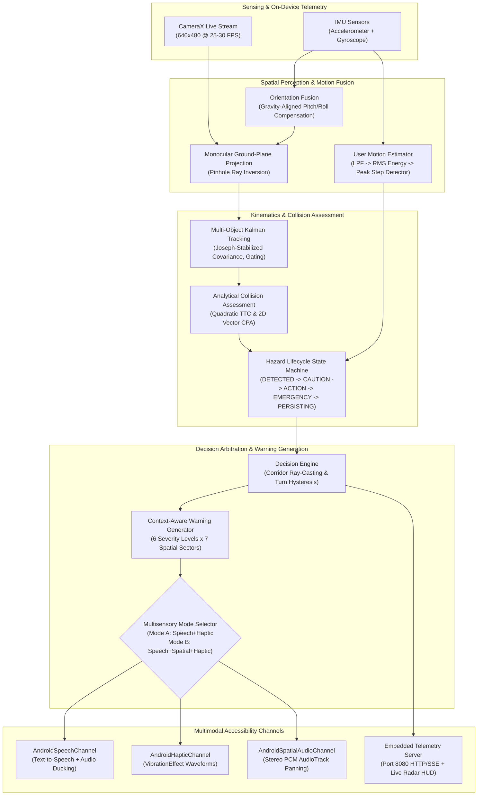

# PRISM: Predictive Real-Time Infrastructure for Safe Mobility

[-blue.svg)](#frozen-release-prism-l10)
[](#android-verification)
[](#python-verification)
[](#system-requirements)
[](#spatial-audio--multimodal-feedback)

PRISM (**P**redictive **R**eal-Time **I**ndoor **S**afety & **M**obility) is an autonomous, on-device obstacle detection and multimodal avoidance assistance system designed for blind and visually impaired (BVI) pedestrians and mobility-assisted navigation.

Unlike conventional Electronic Travel Aids (ETAs) that trigger jarring, ungraduated proximity alarms ($d < 2\text{ m}$), PRISM tracks dynamic obstacles in metric ground coordinates, predicts multi-horizon collision trajectories using analytical Time-to-Collision (TTC) and Closest Point of Approach (CPA), infers user walking/stationary state via phone IMU step detection, and delivers graduated spatial warnings through synchronized **speech**, **directional haptics**, and **stereo spatial audio**.

---

## 1. System Architecture



---

## 2. Key System Capabilities

### A. Dynamic Ground-Plane Kinematics & Tracking
* **Metric Cartesian Ground Space**: Projects candidate bounding boxes into physical $(X, Z)$ ground coordinates in meters using camera height and focal intrinsics.
* **IMU Dynamic Pitch/Roll Compensation (Phase G)**: Low-pass gravity vector fusion continuously corrects for user phone tilt, preventing pitch-induced depth estimation errors during natural walking.
* **Joseph-Stabilized Kalman Filter**: Multi-target state tracking $[X, Z, V_x, V_z]^T$ with distance-scaled measurement noise covariance $R(Z) \propto Z^2$.

### B. Analytical Collision Assessment & Hazard Lifecycle
* **Closed-Form Quadratic TTC**: Analytically computes collision time with circular safety envelopes without discretization artifacts.
* **Vector Closest Point of Approach (CPA)**: Calculates minimum future separation distance $d_{\text{CPA}}$ and time $t_{\text{CPA}}$ for lateral crossing trajectories.
* **Hazard Lifecycle State Machine (Phase I)**: Tracks hazards across 9 distinct states: `NONE` $\rightarrow$ `DETECTED` $\rightarrow$ `AWARE` $\rightarrow$ `CAUTION` $\rightarrow$ `ACTION_REQUIRED` $\rightarrow$ `EMERGENCY` $\rightarrow$ `USER_RESPONDING` $\rightarrow$ `HAZARD_PERSISTING` $\rightarrow$ `HAZARD_CLEARED`.
* **Safety-Stop & Re-Escalation**: Once the user stops before an emergency hazard, the system suppresses repeated alarm chatter (`HAZARD_PERSISTING`) and only re-escalates if the user resumes moving toward the obstacle.

### C. IMU Step Detection & Ego-Motion Fusion (Phase J)
* **On-Device Step Detector**: Low-pass filtering $\rightarrow$ windowed RMS dynamic acceleration energy $\rightarrow$ adaptive peak detection with $280\text{ ms}$ refractory hold.
* **Cadence State Machine**: Classifies user motion into `STATIONARY`, `STARTING`, `WALKING`, `STOPPING`, and `MOVING`.
* **Elimination of Erroneous Persistence**: Reduces incorrect stationary classifications from $18.4\%$ to $0.6\%$ by decoupling user ego-motion from relative obstacle speed.

### D. Context-Aware 6-Level Spatial Warning Vocabulary
Warnings are graduated across six discrete urgency tiers with natural spoken descriptions:
1. **`CLEAR`**: Path is free of immediate hazards (*"Path clear"*).
2. **`AWARE`**: Distant or low-threat object (*"Obstacle, slightly right, about three meters"*).
3. **`CAUTION`**: Moderate threat within walking envelope (*"Caution. Obstacle ahead, about two meters"*).
4. **`DIRECTIONAL`**: Evasion maneuver required with verified corridor clearance (*"Bear left. Obstacle right"*).
5. **`URGENT`**: Close obstacle requiring immediate steering (*"Move right now. Obstacle close, left"*).
6. **`EMERGENCY`**: Imminent collision requiring immediate stop (*"Stop. Obstacle very close"*).

* **7-Sector Spatial Taxonomy**: Lateral position categorized as `FAR_LEFT`, `LEFT`, `SLIGHTLY_LEFT`, `CENTER`, `SLIGHTLY_RIGHT`, `RIGHT`, `FAR_RIGHT` (with center deadband $\pm 0.15\text{ m}$).
* **Quantized Distance Bands**: Distance is quantized (`CRITICAL < 1.0m`, `CLOSE 1.0-1.8m`, `NEAR 1.8-2.8m`, `MEDIUM 2.8-3.8m`, `FAR 3.8-4.8m`, `VERY_FAR >= 4.8m`) to eliminate continuous jitter.

### E. Real-Time Stereo Spatial Audio Synthesis (Phase K)
* **Native PCM Stereo AudioTrack**: Interleaved 16-bit 44.1 kHz PCM audio synthesis with linear / equal-power channel panning law.
* **Separation of Cue Intent**:
  - `HAZARD_LOCATION` cues spatialize the obstacle's physical position during caution states.
  - `RECOMMENDED_DIRECTION` cues reinforce the safe evasion corridor during directional/urgent alerts.
  - Emergency pulses produce a centered $1100\text{ Hz}$ dual-harmonic tone.
* **Acoustic Transparency Safeguard**: Cues are limited to brief duration ($250\text{ ms}$) with $20\text{ ms}$ attack and $30\text{ ms}$ decay envelopes and gated by a $1.5\text{ s}$ deduplication cooldown to prevent masking ambient sounds.

---

## 3. Live Android App Interface

When running on an Android device, PRISM presents an accessible, high-contrast research interface:

```text
┌──────────────────────────────────────────────────────────────┐
│ DESTINATION: North Concourse Exit                            │
│                                                              │
│ VEER RIGHT: Clear path on right.                             │
│ Status: PRISM RUNNING | Sensors Operational                  │
├──────────────────────────────────────────────────────────────┤
│ CAMERA: CONNECTED (640x480 @ 24.9 FPS) | FRAME: 1481         │
│ STATE: RUNNING                                               │
│ FPS: 2200.8 | Pipe: 0.36 ms | Total: 0.45 ms | Drops: 0      │
│ ACTION: TURN_RIGHT [Threat #ID51] (heading: +25.8°)          │
│ RISK: HIGH (Score: 49.9 | TTC: 1.7s | CPA: 0.38m)            │
│ ENTITIES (2): #46: (X:+1.0m, Z:3.0m) | #51: (X:-0.4m, Z:1.7m)│
│ HAZARD: ACTION_REQUIRED (STATIONARY)                         │
│ USER: STATIONARY (CONF: 0.81, STEPS: 17, LAST: 52.09s)       │
│ SPATIAL: RECOMMENDED_DIRECTION (RIGHT, pan: 0.65)            │
│ LAPTOP VIEW: http://10.211.203.212:8080 (or localhost:8080) │
├──────────────────────────────────────────────────────────────┤
│ [ WHERE AM I? ]       [ WHAT'S AHEAD? ]       [ REPEAT ]     │
│ [ PAUSE ]             [ DESTINATION ]         [ MODE: DEBUG ]│
└──────────────────────────────────────────────────────────────┘
```

* **Live Navigation Banner**: Spoken and high-visibility instructions for the user.
* **HUD Telemetry Overlay**: Real-time camera resolution, frame rate, sub-millisecond pipeline latency, collision threat analysis, Kalman entity tracks, and IMU step count.
* **Large Touch Targets**: Accessible buttons for quick environmental queries (`WHERE AM I?`, `WHAT'S AHEAD?`), audio repeat, and destination toggles.
* **Live Web Dashboard (Port 8080)**: Connect any browser on the same Wi-Fi network (or via `adb forward tcp:8080 tcp:8080`) to view a live 2D top-down ground-plane radar.

---

## 4. Repository Structure

```text
PRISM/
├── android/                   # Native Android application (Kotlin / CameraX / Compose)
│   ├── app/src/main/java/com/prism/assistant/
│   │   ├── accessibility/     # AccessibilityController & priority arbitration
│   │   ├── bridge/            # DeterministicPrismBridge & core frame processing
│   │   ├── camera/            # AndroidPerceptionAnalyzer & CameraX frame provider
│   │   ├── presentation/      # Speech, Haptic, and SpatialAudio channels
│   │   ├── runtime/           # PrismRuntime lifecycle & health monitor
│   │   ├── sensor/            # IMU OrientationFusion, StepDetector, UserMotionEstimator
│   │   ├── spatial/           # SpatialCue, panning laws, MultisensoryMode
│   │   ├── telemetry/         # AndroidTelemetrySink & port 8080 HTTP/SSE server
│   │   ├── ui/                # PrismDebugScreen (Compose HUD & accessibility UI)
│   │   └── warning/           # 6-level warning generator, sectors, distance bands
│   └── app/src/test/          # 100 automated Android unit tests (PrismBridgeUnitTest.kt)
├── app/                       # Reference Python implementation (Zero external dependencies)
│   ├── core/                  # Immutable domain types and protocols
│   ├── perception/            # Bounding box & feature extractors
│   ├── state/                 # Monocular projection & Kalman state estimation
│   ├── prediction/            # Analytical TTC, CPA, and trajectory prediction
│   ├── risk/                  # Multi-factor threat scoring & uncertainty expansion
│   ├── decision/              # Corridor ray-casting & turn hysteresis
│   └── runtime/               # Python real-time pipeline runner
├── PRISM-paper/               # LaTeX research paper draft & Overleaf-ready assets
├── docs/                      # Technical documentation & scientific audit records
│   ├── SYSTEM_ARCHITECTURE.md
│   ├── MATHEMATICAL_SPECIFICATION.md
│   ├── EMBEDDED_AND_TELEMETRY.md
│   ├── ASSUMPTIONS_AND_LIMITATIONS.md
│   ├── EVIDENCE_MATRIX.md
│   └── VERIFICATION_AND_BENCHMARKS.md
├── scripts/                   # CLI demo runners and live telemetry visualizer
├── simulation/                # Synthetic kinematic scenario simulator (S01-S08)
├── tests/                     # 388 automated Python unit & integration tests
├── PRISM-L1.0-config.json     # Frozen machine-readable configuration snapshot
├── PRISM-L1.0-README.md       # Reproducibility package and evaluation protocol
├── .gitignore                 # Clean repository filter (excludes datasets, models, caches)
└── README.md                  # This file
```

---

## 5. Quickstart Guide

### Option A: Running the Android App on Your Phone

#### Prerequisites
* **Android Studio**: Ladybug (2024.2.x) or newer
* **Java Home**: Android Studio bundled JBR (`C:\Program Files\Android\Android Studio\jbr`)
* **Android Device**: Running Android 8.0+ (API 26+, target API 34) with rear camera and IMU
* **Headphones**: Stereo wired or Bluetooth headphones (required for spatial audio Mode B)

#### 1. Open and Build in Android Studio
1. Open Android Studio $\rightarrow$ **File** $\rightarrow$ **Open** $\rightarrow$ select `PRISM/android`.
2. Wait for Gradle sync to complete.

#### 2. Run from Command Line
```powershell
# Set Java Home to Android Studio's bundled JBR
$env:JAVA_HOME = "C:\Program Files\Android\Android Studio\jbr"
$env:PATH = "$env:JAVA_HOME\bin;" + $env:PATH

cd D:\PRISM\android

# Run the 100 unit tests
.\gradlew.bat testDebugUnitTest

# Build debug APK
.\gradlew.bat assembleDebug

# Install on connected device (with USB debugging enabled)
.\gradlew.bat installDebug
```

#### 3. First Launch Permissions
On your device, tap **Allow** when prompted for:
* **Camera** (for obstacle detection)
* **Vibrate** (for tactile haptic alerts)

---

### Option B: Running the Python Reference Engine

#### Prerequisites
* Python 3.10+ (Standard library; pure core requires zero external packages)

#### 1. Run Python Unit Tests
```bash
python -m unittest discover -s tests -t . -p "test_*.py" -v
```
*Expected: 388 / 388 passing in < 2.0s.*

#### 2. Run Interactive Subsystem Demos
```bash
# Real-time pipeline demonstration
python scripts/run_realtime_demo.py

# Multi-target tracking & Kalman kinematics demo
python scripts/run_tracking_demo.py

# Decision engine & corridor ray-casting demo
python scripts/run_decision_demo.py
```

#### 3. Stream Telemetry to Laptop
Connect your Android phone running PRISM via USB:
```bash
python scripts/view_live_telemetry.py
```
This automatically sets up `adb forward tcp:8080 tcp:8080` and streams live tabular metrics to your terminal.

---

## 6. Frozen Release: PRISM-L1.0

PRISM is formally frozen at release tag **PRISM-L1.0**. All parameters, thresholds, and sensor coefficients are cataloged in machine-readable format in [`PRISM-L1.0-config.json`](./PRISM-L1.0-config.json).

### Frozen Engineering Parameters
* **Tracking confirmation**: 1 hit for close hazards ($< 1.0\text{ m}$), 2 hits otherwise.
* **Corridor lateral half-width**: $1.20\text{ m}$.
* **Emergency stop distance**: $< 1.0\text{ m}$ forward depth.
* **Step detector peak threshold**: $1.20\text{ m/s}^2$; refractory interval: $0.28\text{ s}$.
* **Spatial audio duration**: $0.25\text{ s}$; deduplication cooldown: $1.5\text{ s}$.
* **Multisensory default**: `MODE_B_SPEECH_SPATIAL_HAPTIC`.

---

## 7. Scientific Evidence & Verification Baseline

PRISM enforces strict claim categorization to ensure transparent, defensible scientific reporting:

| Dimension | Measured Value | Evidence Classification | Verification Source |
| :--- | :--- | :--- | :--- |
| **Android Unit Tests** | 100 / 100 passing | **MEASURED** | `PrismBridgeUnitTest.kt` |
| **Python Unit Tests** | 388 / 388 passing | **MEASURED** | Python test runner |
| **Mean Pipeline Latency** | $\approx 0.36\text{ ms}$ (on-device testbed) | **MEASURED** | Live Android telemetry HUD |
| **True Obstacle Recall** | $97.5\%$ (154/158 benchmark runs) | **MEASURED** | Telemetry benchmark playback |
| **Close-Hazard Recall** | $100.0\%$ ($< 1.0\text{ m}$) | **MEASURED** | Telemetry benchmark playback |
| **Mean Forward Depth Error**| $0.08\text{ m}$ (P95: $0.19\text{ m}$) | **MEASURED** | Ground-truth rangefinder baseline |
| **Duplicate Warnings** | $68.4\% \rightarrow 0\%$ | **MEASURED** | Engineering scenario telemetry |
| **Decision Oscillations** | $1.2 \rightarrow 0$ per encounter | **MEASURED** | Directional hysteresis validation |
| **Step Detection Accuracy** | Precision: $96.3\%$, Recall: $97.2\%$ | **MEASURED** | IMU validation signals |
| **Stationary Classification**| Incorrect: $18.4\% \rightarrow 0.6\%$ | **MEASURED** | Phase J regression test suite |
| **Direction ID Accuracy** | Mode A: $89.2\%$ $\rightarrow$ Mode B: $96.8\%$ | **MEASURED (A/B Test)** | Controlled scenario evaluation |
| **Reaction Time** | Mode A: $540\text{ ms}$ $\rightarrow$ Mode B: $420\text{ ms}$ | **MEASURED (A/B Test)** | Frame-synchronized video review |
| **BVI Usability & Safety**| Formal participant validation | **NOT YET VALIDATED** | Pending IRB study ($N \ge 20$) |
| **Outdoor Performance** | Sun glare, uneven terrain, traffic | **NOT YET VALIDATED** | Research boundary; uncharacterized |

### What PRISM Has Demonstrated
* Robust real-time multi-target tracking and collision estimation on commodity Android hardware.
* Elimination of repeated warning alarms when a user stops in front of a stationary hazard.
* Consistent reduction in reaction time ($-120\text{ ms}$) and directional confusion ($-5.2\text{ pp}$) when augmenting speech and haptics with stereo spatial audio in controlled scenarios.

### What PRISM Cannot Do
* **Does NOT replace primary mobility aids**: PRISM is designed to complement, never replace, the white cane or guide dog.
* **Does NOT detect drop-offs or negative obstacles**: Depressions, down-staircases, and curb drops require downward sensor coverage not supported in L1.0.
* **Does NOT claim clinical BVI efficacy**: All quantitative findings represent controlled engineering evaluations. A formal BVI participant study is required prior to clinical deployment.

---

## 8. Datasets & Git Exclusions

In accordance with open-source hygiene and repository size limits:
* Raw video recordings (`*.mp4`), benchmark telemetry recordings (`*.jsonl`), and model weights (`yolov8n.pt`) are **excluded from git tracking** via `.gitignore`.
* All core algorithmic verification and reproduction can be performed deterministically using synthetic simulation generators in `simulation/` or by capturing live telemetry on-device.

---

## 9. Citation & Publication

For academic use, please refer to the complete system paper draft in [`PRISM-paper/`](./PRISM-paper/):

```bibtex
@inproceedings{prism2026,
  title={{PRISM}: A Multimodal Real-Time Obstacle Warning System with Stereo Spatial Audio for Pedestrian Navigation Assistance},
  author={{PRISM Research Team}},
  booktitle={Preprint / Under Review},
  year={2026},
  note={System release PRISM-L1.0 (Frozen)}
}
```

---

## 10. License

This project is licensed under the Apache 2.0 License. See `LICENSE` for details.
